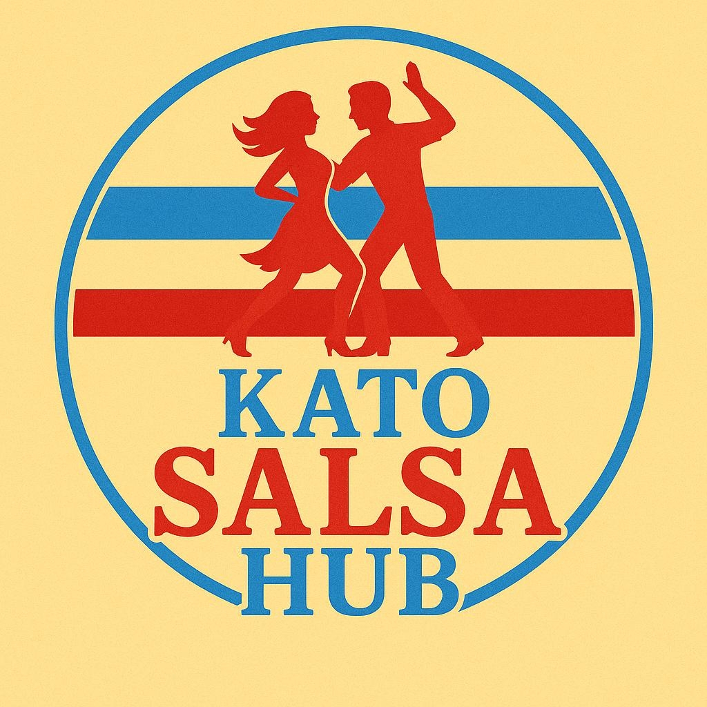
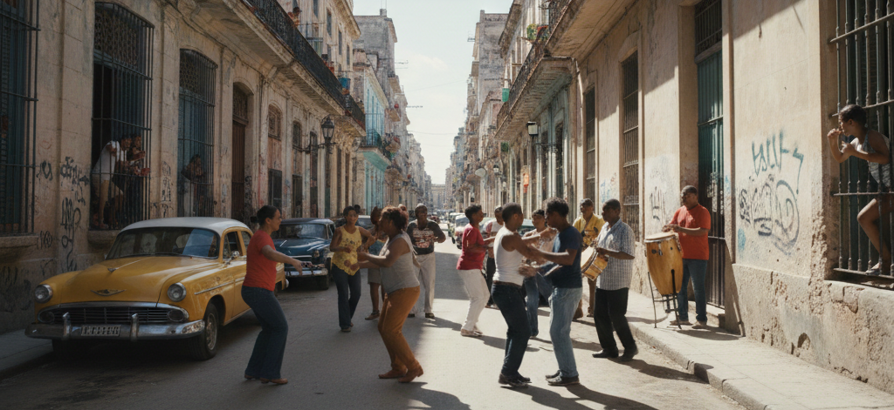

<p align="center">
  
</p>

<h1 align="center">Kato Salsa Hub & DancePuls — Społecznościowa Platforma Taneczna</h1>

<p align="center">
  <strong>Oficjalny portal społeczności tancerzy Salsy, Bachaty i Kizomby na Śląsku oraz inteligentny agregator wydarzeń DancePuls.</strong><br>
  Vanilla JS SPA • Optymalizacja Cloudflare • Internetowy Radio Player • Baza wiedzy Salsopedia • Automatyzacja wydań i potoków CI/CD.
</p>

<p align="center">
  
  
  
  
  
  
</p>

<p align="center">
  <a href="https://katosalsahub.pl" target="_blank">
    
  </a>
  <a href="https://katosalsahub.pl/grafik.html" target="_blank">
    
  </a>
</p>

---

## 📸 Podgląd Serwisu

<p align="center">
  
</p>

---

## 🎯 Czym jest Kato Salsa Hub & DancePuls?

**Kato Salsa Hub** to oddolna inicjatywa społeczna oraz oficjalny portal **Fundacji Kato Salsa Hub**, integrujący tancerzy muzyki latynoskiej (Salsa, Bachata, Kizomba) na terenie Katowic, aglomeracji śląskiej i Małopolski.

Projekt rozwiązuje kluczowe wyzwania społeczności tanecznej:
- **Wspólny Grafik Szkół i Kalendarz Imprez DancePuls (`katosalsahub.pl/grafik.html`):** Agregacja 128 kursów tanecznych oraz imprez, festiwali, maratonów i warsztatów z wielu źródeł (social media, szkoły tańca, kluby) w jednym, responsywnym widoku.
- **Dedykowany Odtwarzacz Radiowy (Radio Player):** Płynny streaming stacji muzycznych (Salsa Dura, Bachata Sensual, Kizomba) z obsługą API `MediaSession` (sterowanie z poziomu lockscreena telefonu).
- **Encyklopedia Taneczna (Salsopedia):** Baza wiedzy o stylach tańca (Salsa Casino, Linear On1/On2, Timba), etykiecie na parkiecie i historii muzyki afro-kubańskiej.
- **Oficjalne Biuro Obsługi (Helpdesk osTicket):** Bezpieczny system zgłoszeń dla uczestników i wolontariuszy pod domeną `hd.twojastronawww.pl`.

---

## ✨ Kluczowe Możliwości i Moduły

### 🎪 Ekosystem Serwisów i Aplikacji
| Moduł / Ścieżka | Technologia | Specyfikacja i Gwarancje |
| :--- | :--- | :--- |
| **Kato Salsa Hub** (`katosalsahub.pl/`) | Vanilla JS SPA & CSS Grid | Wizytówka fundacji, relacje ze spotkań plenerowych, interaktywna mapa 8 miejscówek, integracja social media. |
| **Wspólny Grafik & Imprezy** (`katosalsahub.pl/grafik.html`) | Dynamiczny silnik filtrowania JS | Zintegrowana wyszukiwarka 128 kursów tanecznych, kalkulator karnetów i kalendarz imprez DancePuls. |
| **DancePuls Studio** (`katosalsahub.pl/dancepuls/`) | Panel kuratorski & Generator FB | Narzędzie redakcyjne dla kuratorów wydarzeń, generator postów/ankiet na FB i skrzynka zgłoszeń CSV. |
| **Radio Player** | HTML5 Audio & `MediaSession API` | Płynne przełączanie kanałów, automatyczne ponawianie połączenia, sterowanie z powiadomień mobilnych. |
| **Silnik Synchronizacji** (`scripts/sync_engine.js`) | Node.js Automatyzacja | Agregacja, normalizacja i deduplikacja wydarzeń, generowanie raportów i powiadomień. |
| **Helpdesk & Zgłoszenia** | osTicket (ITIL 4) | Bezpieczne formularze kontaktowe zintegrowane z centralnym systemem obsługi zgłoszeń. |

---

## 🏛️ Architektura i Bezpieczeństwo

```plaintext
katosalsahub/
├── .github/                        # Potoki CI/CD (ci.yml, deploy.yml, weekly-report.yml) i Dependabot
├── .githooks/                      # Git hooki: pre-commit (npm run check), commit-msg (Conventional Commits)
├── .vscode/                        # Standaryzacja IDE (settings.json, tasks.json)
├── katosalsahub.pl/                # Zintegrowana aplikacja produkcyjna (DocumentRoot LH.pl)
│   ├── assets/
│   │   ├── css/                    # System tokenów CSS, komponenty, sekcje, radio, wiki, grafik
│   │   ├── js/                     # Moduły Vanilla JS (router, home, radio, wiki, wiki-studio, schedule)
│   │   ├── php/                    # Bezpieczne API (contact.php, wiki.php z ochroną Anti-TOCTOU)
│   │   └── data/                   # Centralna baza SSOT (salsopedia.json, schedule.json, events.json, events_database.md)
│   ├── dancepuls/                  # Panel kuratorski DancePuls i generator postów FB
│   ├── index.html                  # Główny punkt wejścia i szkielet SPA
│   ├── grafik.html                 # Wspólny Grafik Szkół Tańca i Kalendarz Imprez
│   ├── salsopedia.html             # Encyklopedia Salsopedia (ponad 200 haseł i figur)
│   └── privacy.html                # Polityka prywatności i RODO
├── scripts/                        # Automatyzacja Backend/CLI (serve.js, sync_engine.js, sync-schedules.js, sync-layout.js)
├── tests/                          # Natywne testy jednostkowe (node:test) i symulator DOM
├── BLUEPRINT.md                    # Podręcznik architektury, runbook wdrożeniowy i szablony SEO
├── SECURITY.md                     # Polityka bezpieczeństwa (ISO 27001 / RODO)
├── package.json                    # Skrypty jakościowe, synchronizacji i raportowania
└── README.md                       # Dokumentacja główna projektu
```

---

## 🛡️ Brama Jakości & Bezpieczeństwo (Wzorzec Gal Anonim)

Zgodnie ze standardami inżynierskimi wypracowanymi w projektach **Gal Anonim** i **TwojaStronaWWW**:
* **Ochrona Przed Wyciekiem Sekretów:** Wdrożony audyt kodu i blokada hardkodowanych haseł oraz tokenów API.
* **Optymalizacja Wydajności Cloudflare:** Pełne buforowanie zasobów statycznych, certyfikaty SSL/TLS, ochrona DDoS i optymalizacja ładowania zasobów mobilnych.
* **Zgodność z RODO:** Minimalizacja pól formularza kontaktowego, przejrzysta polityka cookies i prywatności.

---

## 💻 Komendy Deweloperskie

```bash
# 1. Sklonuj repozytorium
git clone https://github.com/TwojaStronaWWW/katosalsahub.git
cd katosalsahub

# 2. Uruchomienie silnika synchronizacji wydarzeń DancePuls
npm run sync

# 3. Wygenerowanie raportu stanu bazy wydarzeń
npm run report
```

---

## 🗺️ Podręcznik Inżynieryjny i Runbook

Kompletny opis architektury, procedur wdrożeniowych CI/CD oraz gotowych szablonów SEO znajduje się w pliku:  
👉 **[BLUEPRINT.md](BLUEPRINT.md)**

---

## 👥 Zarząd i Społeczność

* **Organizacja:** Fundacja Kato Salsa Hub (KRS w toku)
* **Prezes Zarządu & Architektura:** Krzysztof Początek
* **Partner Technologiczny:** [TwojaStronaWWW](https://github.com/TwojaStronaWWW)
* **Prawa autorskie:** &copy; 2026 Fundacja Kato Salsa Hub. Wszelkie prawa zastrzeżone.
